<picture>
  <source media="(prefers-color-scheme: dark)" srcset="assets/header-dark.svg">
  
</picture>

<picture>
  <source media="(prefers-color-scheme: dark)" srcset="assets/typing-dark.svg">
  
</picture>

&nbsp;
&nbsp;
&nbsp;

 

I build web applications end to end with **ASP.NET Core** and **Angular**, from the database to the UI. 
Currently maintaining a multi-tenant **university ERP used by 750+ active users**.

 

<h2 align="center">About me</h2>

<picture>
  <source media="(prefers-color-scheme: dark)" srcset="assets/about-dark.svg">
  
</picture>

<h2 align="center">Tech stack</h2>

<picture>
  <source media="(prefers-color-scheme: dark)" srcset="assets/stack-dark.svg">
  
</picture>

<h2 align="center">Journey</h2>

<picture>
  <source media="(prefers-color-scheme: dark)" srcset="assets/journey-dark.svg">
  
</picture>

<b>Experience, education and certifications</b>

 

#### .NET Developer, Enterprise ERP Systems &nbsp;·&nbsp; Informatique Education
`May 2026 – Present` &nbsp; Cairo, Egypt
- Maintain core modules of a multi-tenant university ERP platform (ASP.NET WebForms, C#, SQL Server) serving 750+ active users across multiple institutional deployments.
- Eliminate recurring production failures in core student workflows by diagnosing systemic defects across dozens of screens, tracing root causes through session state, business logic and database constraints.

#### Part-Time Technical Instructor &nbsp;·&nbsp; iSchool DEMI
`Jan 2026 – May 2026` &nbsp; Remote
- Taught Problem Solving, Data Structures & Algorithms and web fundamentals.
- Turned complex concepts into practical, beginner-friendly lessons.

#### Freelance Full Stack .NET Developer
`Sep 2023 – Present` &nbsp; Remote
- **[Jadeer Logistics](https://aboelhassan-developer.github.io/Jadeer_Website/)**: bilingual (AR/EN) landing page with full RTL/LTR support, built with Bootstrap 5 and SCSS.
- **E-commerce solution**: scalable store for a Saudi retail client using Angular, .NET Core and Stripe, with a smooth checkout, role-based access control and a responsive UI.

#### Education
**B.Sc. Computer and Information Technology**, Faculty of Computers and Information, Assiut University &nbsp;`2019 – 2023`
- GPA 3.38 / 4.0. Graduation project, a Healthcare Record Management System built with ASP.NET Core MVC, graded Excellent.

#### Training
- **Full Stack .NET & Angular**, Information Technology Institute (ITI) &nbsp;`Oct 2024 – Jul 2025`
- **Backend Bootcamp**, Career 180 &nbsp;`Feb 2024 – Jun 2024`

#### Certifications
- ECPC 2022, Egyptian Collegiate Programming Contest
- ICPC Assiut University Community, Newcomers Training

<h2 align="center">Featured projects</h2>

<table>
  <tr>
    <td width="50%" valign="top">
      <picture>
        <source media="(prefers-color-scheme: dark)" srcset="assets/project-dating-dark.svg">
        
      </picture>
      

        
        
      

    </td>
    <td width="50%" valign="top">
      <picture>
        <source media="(prefers-color-scheme: dark)" srcset="assets/project-skishop-dark.svg">
        
      </picture>
      

        
        
      

    </td>
  </tr>
  <tr>
    <td width="50%" valign="top">
      <picture>
        <source media="(prefers-color-scheme: dark)" srcset="assets/project-ecommerce-dark.svg">
        
      </picture>
      

        
      

    </td>
    <td width="50%" valign="top">
      <picture>
        <source media="(prefers-color-scheme: dark)" srcset="assets/project-movies-dark.svg">
        
      </picture>
      

        
      

    </td>
  </tr>
</table>

<b>Project highlights</b>

 

**Dating App**
- JWT authentication with refresh tokens and role-based authorization (Member, Moderator, Admin).
- Real-time messaging and online presence tracking with SignalR.
- Photo upload and management with Cloudinary, containerized with Docker.

**SkiShop**
- Clean Architecture with the Repository, Specification and Unit of Work patterns.
- Stripe payments, Redis caching for performance and basket persistence.
- Real-time order notifications with SignalR, Angular 19 storefront with filtering, checkout and order history.

**E-Commerce Web App**
- Six functional modules: authentication, products, cart, wishlist, orders and an admin dashboard.
- Secure ASP.NET Core REST API with JWT and a responsive Angular frontend.

**Movie Browser**
- Now playing, search and full movie details from the TMDB API, with recommendations.
- Wishlist saved in local storage, state managed with RxJS.
- English, Arabic, French and Chinese with automatic RTL/LTR switching.

<h3 align="center">More projects</h3>

| Project | What it does | Built with |
|:--|:--|:--|
| **[Live Chat App](https://github.com/AboElhassan-Developer/LiveChatApp)** | Real-time chat over a SignalR hub with chat sessions and stored message history | ASP.NET Core, SignalR, EF Core, Angular 19 |
| **[Company Sign-Up System](https://github.com/AboElhassan-Developer/company-signup)** · [video](https://youtu.be/3yYLokzsB4w) | Company onboarding with OTP email verification, password rules and logo upload | .NET 8 Web API, Clean Architecture, PostgreSQL, Angular |
| **[Online Pharmacy Management](https://github.com/AboElhassan-Developer/Online_Pharmacy_Management_System)** | Medicines, patients, suppliers, invoices and orders with role-based access | ASP.NET Core MVC, Identity, EF Core, SQL Server |
| **[Task Management System](https://github.com/AboElhassan-Developer/TaskManagementSystem-WebForms)** · [video](https://youtu.be/XMGh6OifAm4) | Admins create and assign tasks with attachments, members track and update them | ASP.NET WebForms, C#, Entity Framework, SQL Server |
| **[Blocked Countries API](https://github.com/AboElhassan-Developer/BlockedCountriesAPI)** | Permanent and temporary country blocking by IP, lookups, attempt logging and a background cleanup service | .NET 8 Web API, Background Services, Swagger |
| **[Digital Notes Manager](https://github.com/AboElhassan-Developer/DigitalNotesManager)** | Desktop notes app with categories, reminders, search and hashed passwords | WinForms, EF Core, SQL Server LocalDB |
| **[Employee & Department Manager](https://github.com/AboElhassan-Developer/Emp-Department-manager)** | Employees, departments and projects with accounts and roles | ASP.NET Core MVC, Repository Pattern, EF Core |
| **[Task Management App](https://github.com/AboElhassan-Developer/task-management-app)** | Task CRUD with statuses and JWT login | Vue 3, Quasar, Node.js, Express, MySQL |
| **[Online Store](https://github.com/AboElhassan-Developer/E-commerce-Dashboard)** · [live](https://aboelhassan-developer.github.io/E-commerce-Dashboard/) | Storefront with an admin dashboard for products and categories, including image uploads | Node.js, Express, Multer, Bootstrap |
| **[Jadeer Logistics](https://github.com/AboElhassan-Developer/Jadeer_Website)** · [live](https://aboelhassan-developer.github.io/Jadeer_Website/) | Bilingual logistics landing page with full RTL/LTR layouts | HTML, SCSS, Bootstrap 5, JavaScript |
| **[Movies API](https://github.com/AboElhassan-Developer/MoviesAPI)** | REST API for movies and genres | ASP.NET Core Web API, EF Core |

  

<h2 align="center">GitHub activity</h2>

<picture>
  <source media="(prefers-color-scheme: dark)" srcset="https://raw.githubusercontent.com/AboElhassan-Developer/AboElhassan-Developer/output/stats-dark.svg">
  
</picture>

<picture>
  <source media="(prefers-color-scheme: dark)" srcset="https://raw.githubusercontent.com/AboElhassan-Developer/AboElhassan-Developer/output/snake-dark.svg">
  
</picture>

 

<picture>
  <source media="(prefers-color-scheme: dark)" srcset="assets/footer-dark.svg">
  
</picture>
